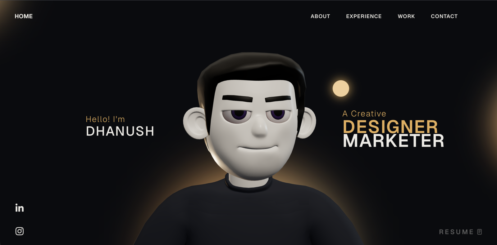

<div align="center">



<br>

**An interactive 3D portfolio.** React, TypeScript, GSAP and Three.js.

<br>


</div>



<div align="center">
  
</div>


## What it is

A single-page portfolio built around a 3D character who sits at a desk and
types. The page is one continuous scroll: the camera pulls back from a
close-up of his face, the desk assembles around him, the monitor lights, and
the work section slides past horizontally while the page is pinned.

| | |
|---|---|
| **Scroll choreography** | GSAP ScrollSmoother drives the page; ScrollTrigger timelines move the camera, rotate the character and assemble the desk |
| **3D scene** | Three.js with a Draco-compressed model, a runtime-generated gradient environment map, and pointer-tracked head rotation |
| **Work section** | Seven projects in a horizontally-scrolling row, pinned while it travels, each with a real screenshot of the live deployment |
| **Loading screen** | Progress eased on a clock rather than guessed, held to a floor so the intro can be read, then a circular wipe into the page |
| **Responsive** | Verified 320px to 1920px |


## Quick start

```bash
npm install
npm run dev          # http://localhost:5173
```

```bash
npm run build        # -> dist/
npm run preview
```

Node 22, pinned in `.nvmrc`. The dev server binds loopback only; there is
deliberately no `--host` flag on the `dev` script.


## Where the content lives

**Everything a visitor reads is in `src/config.ts`.** Edit there, not in the
components. One file holds the hero text, the About copy, the two What-I-Do
cards, the career timeline, the project list, the tech-stack logos, the
contact details, the social links and the nav labels.

```
src/
├── config.ts                  all visitor-facing content
├── index.css                  palette: ten CSS custom properties
└── components/
    ├── Character/             Three.js scene, lighting, animation
    ├── utils/GsapScroll.ts    scroll choreography
    └── styles/                per-component CSS
```

Change the ten palette custom properties in the `:root` block of
`src/index.css` and the whole site reskins at once. It currently runs a warm
amber on a deep ink base.


## Provenance and licence

Built on the [MoncyDev portfolio template](https://www.moncy.dev), which ships
a **Personal Portfolio License (PPL) v1.0**. See [`LICENSE`](LICENSE) for the
full text.


## Credits

**Template** · [Moncy Yohannan](https://www.moncy.dev) · design and 3D assets, under PPL v1.0

**Content and build** · Lokesh T

**Portfolio of** · Dhanush S · [LinkedIn](https://www.linkedin.com/in/dhanush-s-63a003322/)

<div align="center">
<br>
<sub>Built with React, TypeScript, GSAP and Three.js.</sub>
</div>
